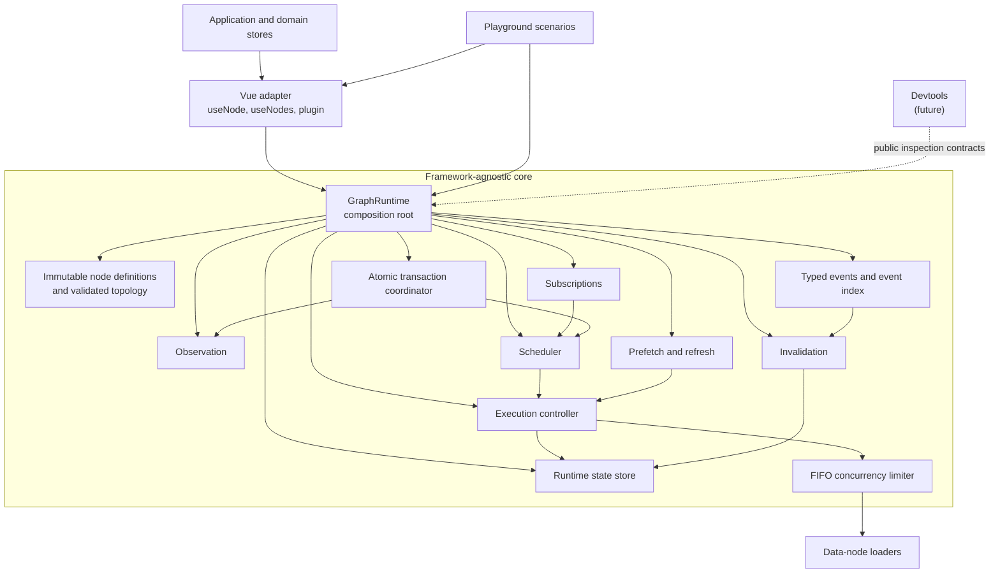

# System Overview

## Architectural direction

The framework uses one package and one repository. Logical layers are separated by source folders and explicit import boundaries.



The diagram shows the current implemented runtime composition, including typed event indexing, publication matching, and transaction-aware event staging. Devtools remains a future consumer of public inspection contracts. Later roadmap capabilities are described in their dedicated architecture documents and are not presented here as current runtime components.

The playground and devtools consume public inspection APIs. They must not reach into private core internals.

## Layer responsibilities

### `src/core`

Framework-agnostic TypeScript. It must not import Vue, Pinia, browser lifecycle APIs, devtools UI, or playground code.

Responsibilities:

- Typed node and event definitions
- Registry and graph indexes
- Graph validation
- Node subscription tracking
- Node state machine
- Scheduling and execution
- Transactions
- Invalidation
- Refresh and polling policies
- Optimistic mutations
- Failure propagation
- Metrics and diagnostic events
- Snapshot export

### `src/vue`

Vue 3.5 integration.

Responsibilities:

- Convert core observations into Vue refs
- `useNode`, `useNodes`, and `useQuery`
- Scope-aware node subscription and cleanup
- Vue plugin and graph injection
- Reactive aggregate loading and error state
- Browser lifecycle integration where appropriate

### `src/devtools`

Optional inspection and visualisation.

Responsibilities:

- Dependency graph view
- Node inspector
- Execution and event timeline
- Transaction timeline
- Metrics dashboard
- Snapshot export and comparison

Devtools code must be tree-shakeable or excluded from production application usage.

### `src/playground`

A controlled Vue application where developers can change latency, failures, dependencies, contexts, event publication, mutation outcomes, and polling completion without relying on a product backend.

## Why one package

A single package is preferred during research and development because:

- Core, Vue integration, diagnostics, and playground evolve together.
- There is no current need for independent publication or versioning.
- Local imports and build configuration remain simpler.
- API experimentation does not require coordinating package releases.

Logical boundaries are still important. Moving to multiple packages later remains possible if independent consumption or versioning becomes necessary.

## Core operating model

1. Nodes and events are registered.
2. A consumer creates subscription for one or more nodes.
3. The scheduler finds subscribed nodes that are not fresh.
4. Required ancestors are included automatically.
5. Ready nodes execute concurrently where safe.
6. Changes are published to observers.
7. Context updates, events, mutations, or refresh policies may invalidate nodes.
8. Only subscribed stale nodes and required ancestors are scheduled again.

## Implemented Vue runtime ownership

The Vue adapter supports two runtime-resolution paths:

```text
Vue component
    |
    +-- explicit runtime --> Pinia store --> GraphRuntime
    |
    `-- injected runtime --> Vue plugin --> GraphRuntime
```

Both paths use the same `useNode` and `useNodes` composables and the same framework-agnostic core runtime. An explicit runtime takes precedence over injection.

Pinia is an application integration choice, not a core dependency. A Pinia store may create and own one runtime per Pinia instance, but it must not mirror node values, status, errors, subscriptions, or scheduler state. See `docs/architecture/07-vue-and-pinia-integration.md`.

## Important boundaries

- A node dependency means the loader requires the dependency's successful value.
- An invalidation event means the node may be out of date. It is not a data value.
- A transaction batches local graph changes. It does not provide backend atomicity.
- Node subscription controls whether stale data should be refreshed automatically. `subscribeNodes(...)` does not invoke loaders synchronously; a non-empty subscription requests a coalesced scheduler microtask.
- Polling is a refresh policy, not a recursive loader implementation.

## Validation model

The contained environment prepares files and performs static inspection. The developer performs package installation, type checking, tests, builds, and runtime validation offline. Documentation and roadmap status must distinguish prepared changes from validated changes.
