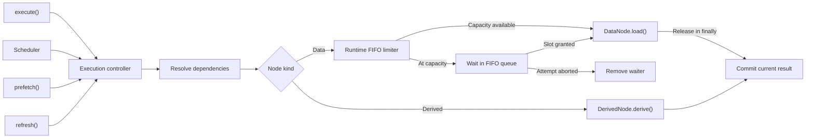

# Execution, Scheduling, Transactions, and Concurrency

## Runtime separation

Immutable node definitions and validated topology may be shared by multiple runtime instances. Each `GraphRuntime` independently owns values, statuses, freshness, errors, generations, listeners, subscriptions, scheduler state, active promises, and abort controllers.

## Runtime state

Execution status and freshness are separate:

```ts
type NodeStatus =
  | "idle"
  | "loading"
  | "success"
  | "refreshing"
  | "error";

type NodeFreshness = "fresh" | "stale";
```

A node may retain stale successful data while refreshing or after a refresh error.

Context nodes begin successful and fresh. Data nodes begin with their initial value but without a successful execution. Derived nodes use `undefined` before their first successful derivation.

## Dependency-aware execution

```ts
await runtime.execute([Targets, Credits]);
```

Execution starts from requested targets, includes transitive ancestors, skips fresh successful values, and excludes unrelated nodes.

The runtime recursively ensures parents before a child. Independent parent promises and independent top-level targets are started together and awaited with `Promise.allSettled`, providing real concurrency without a separate wave planner.

Context nodes require no loader. Data nodes receive typed dependency access and an attempt-scoped `AbortSignal`. Derived nodes execute synchronously after their dependencies are successful and fresh.

## Data-load concurrency limit

`createGraphRuntime` accepts an optional runtime-wide limit:

```ts
const runtime = createGraphRuntime(graph, {
  maxConcurrentLoads: 6,
});
```

The runtime owns one FIFO counting semaphore. A data-node attempt acquires a slot immediately before calling `load()` and releases it in `finally`. A queued attempt that is aborted is removed without invoking its loader. The same limit applies across explicit execution, scheduler work, prefetch, and refresh. Derived nodes do not acquire slots, and separate runtimes do not share capacity. The default is unlimited concurrency.



## In-flight sharing

A runtime stores one active attempt per node generation. Overlapping explicit, scheduled, prefetch, and refresh work shares that attempt rather than invoking the loader repeatedly.

Different runtime instances never share attempts. A new generation does not reuse obsolete work.

## Generations and cancellation

Each node has a generation. Context changes and refresh preparation can advance generations. Attempts capture their starting generation and a unique token.

A result commits only when the current generation and active token still match. This prevents an API that ignores abort from overwriting newer state.

Affected active work is aborted using attempt-scoped controllers. Abort and superseded results are not recorded as business errors.

## Branch-scoped failures

A directly failed node records an error. Descendants that require it are blocked and do not execute. Independent branches continue.

After executable branches settle, the caller receives `GraphExecutionError`, containing direct and blocked failure records. Per-node state remains available for UI and diagnostics.

## Node subscriptions

```ts
const subscription = runtime.subscribeNodes([Targets]);
```

A subscription contributes direct ownership for requested targets and required ownership for transitive ancestors. Contributions are deduplicated within one subscription, including shared and diamond ancestors.

Subscription registration is synchronous and does not invoke loaders synchronously. A non-empty subscription requests one coalesced scheduler microtask.

Cleanup is idempotent:

```ts
subscription.unsubscribe();
```

## Automatic scheduler

The scheduler recalculates current directly subscribed targets at flush time and delegates all work to the single dependency-aware execution engine.

Properties:

- synchronous schedule requests coalesce
- one flush runs at a time per runtime
- changes during a flush request one recalculated follow-up pass
- scheduler errors are captured rather than becoming unhandled rejections
- a failed subscribed node does not enter an automatic retry loop
- a later context change or new subscription is an explicit retry trigger

Inspect scheduler state:

```ts
runtime.getSchedulerState();
```

Await scheduler quiescence:

```ts
await runtime.whenSettled();
```

`whenSettled()` describes queued, running, and follow-up scheduler work. It resolves after scheduler success, failure, or scheduler-owned cancellation. It does not describe caller-owned prefetch or refresh operations.

## Cancellation ownership

Active attempts track execution origins. The final unsubscribe aborts work only when the attempt is scheduler-owned and no current subscription requires the node.

Work remains active when another subscription still requires it or when an explicit, prefetch, or refresh caller also owns the attempt.

## Prefetch and refresh

```ts
await runtime.prefetch([Targets]);
await runtime.refresh([Targets, Summary]);
```

Prefetch is a caller-owned one-shot execution without persistent subscription ownership. It skips fresh successful values.

Refresh accepts data and derived targets, advances their generation, preserves previous successful values, and forces execution. A changed successful result invalidates transitive descendants. An `Object.is` equal result does not.

Callers await these operations directly. Their failures reject with `GraphExecutionError` and do not automatically become scheduler errors.

## Stale-after refresh ownership

A subscribed stale-after data node receives one runtime-owned timer after successful execution. Timer expiry delegates to normal refresh preparation and execution with the internal `refresh-policy` origin. Manual and policy refresh of the same target share work.

Final unsubscribe aborts an active attempt only when all owners are automatic (`scheduler` or `refresh-policy`). Any explicit, prefetch, or manual-refresh owner protects the attempt. Policy timers are not included in scheduler settlement, so `whenSettled()` remains finite for future recurring policies.

## Fixed interval scheduling

Interval policies use recursive timeouts rather than `setInterval(...)`. One timeout exists per subscribed interval node. Expiry requests a policy-owned refresh through the existing operation and execution controllers. The next timeout is created only after successful policy work fully settles, preventing overlapping requests and avoiding a race with shared refresh-operation cleanup.

A failed interval refresh schedules no next timeout in M8C. Retry and backoff remain M8E work. Context or event invalidation closes the previous timing session; successful execution for the new generation starts a new full interval.

## Poll-until sessions

Poll-until uses the same recursive policy timeout and policy-owned refresh origin as fixed interval. A runtime-local session holds polling start time, evaluated generation, timer token, operation settlement state, and terminal state.

Policy-owned refresh generation changes continue the same cycle. External invalidation closes the prior cycle and a later successful generation starts a clean cycle. Terminal error mutation verifies generation before preserving data and changing only status, freshness, and error.

Polling timers remain outside scheduler settlement. `whenSettled()` continues to describe automatic dependency scheduling, not future polling ticks.

## Retry and pause scheduling

Policy retries remain inside the refresh-policy controller and delegate every attempt to the existing refresh and execution path. Backoff is bounded, jitter uses the injected random source, and retries never overlap active policy work.

Pause clears timers while retaining one remaining delay and timer purpose. Resume restores at most one timeout. Active loads continue during pause, and recurring policy timers remain outside scheduler settlement.

## Release-policy ownership

Implemented, Milestone 12 - see [ADR-016](../decisions/ADR-016-value-release-policies.md).

A sibling release-policy controller owns one timer per eligible data node, started the moment that node's subscriber count - direct plus required, the same total `hasSubscribers` check invalidation and the scheduler's settlement logic already use, not the scheduler's own `hasDirectSubscribers` filter - drops to zero while the node still has a successful value. Resubscribing before the timer fires cancels it with no other effect; the existing value is reused exactly as if nothing had happened.

When the timer fires, the controller resets the node to its never-executed shape and bumps its generation through the same state-transition path `execution.ts` uses for every other reset, rather than a bespoke code path - a resubscribe afterward looks, to the execution machinery, identical to a node that has simply never run yet. The refresh-policy and release-policy controllers share one injected timer environment (`TimerEnvironment`) rather than two near-identical clocks.

A node with an active refresh policy needs no special-casing here: refresh policies already stop entirely once a node's last subscriber leaves (this section, above), so a release timer never starts while a refresh policy is still doing anything to conflict with.

## Runtime disposal

`runtime.dispose()` releases the runtime's background resources and is idempotent. It detaches the refresh-policy and release-policy `onChange` hooks, then disposes both controllers: pending timers are cleared, the refresh controller unsubscribes from the timer environment's pause signal, and a policy refresh that settles afterwards schedules no follow-up work.

Disposal is deliberately narrow. It does not abort in-flight loads, reject later calls, or clear state and subscriptions; loading, `refresh`, `mutate`, and existing subscriptions keep working, and diagnostic snapshots stay available. Only the background policies stop.

## Transaction sessions

```ts
await runtime.transaction(async transaction => {
  transaction.setContext(JobSeekerId, firstValue);
  await localWork();
  transaction.setContext(JobSeekerId, finalValue);
});
```

Each top-level `runtime.transaction(...)` call creates one independent `TransactionSession`. The session stages context changes and event publications, validates context generations before commit, and applies all committed effects in one synchronous graph commit. A failed callback discards only that session's staged work.

There is no ambient transaction group and no notification buffer. Observer notification and scheduler dispatch are direct runtime capabilities. A successful session notifies and schedules immediately even while another unrelated transaction callback remains open.

Explicit same-session composition uses the handle:

```ts
await runtime.transaction(async transaction => {
  transaction.setContext(ContextA, valueA);
  await transaction.transaction(async nested => {
    nested.setContext(ContextB, valueB);
  });
});
```

`transaction.transaction(...)` reuses the owning session. Ordinary async error propagation determines whether the outer callback catches a nested failure or lets the whole session roll back.

`runtime.whenSettled()` describes scheduler settlement only. Await the transaction promise before calling `whenSettled()` when commit-triggered scheduler work must complete. Open sessions that have not committed are outside the settlement contract.

## Transaction ownership boundary

Transaction membership is explicit:

- `transaction.setContext(...)` and `transaction.publish(...)` belong to that handle's session;
- `transaction.transaction(...)` composes work into the same session;
- each top-level `runtime.transaction(...)` call creates a separate session;
- plain runtime operations read and update committed state immediately;
- disjoint sessions commit or roll back independently in completion order;
- overlapping sessions that stage the same context use generation-based first-commit-wins conflict detection;
- conflicted sessions apply no context, event, notification, or scheduler effect;
- diagnostic operation and cause IDs remain attached to the owning session.

The transaction model is local to one graph runtime. It does not provide remote, distributed, or cross-service rollback.

