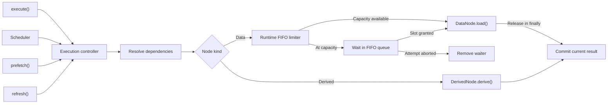

# Execution, Scheduling, Transactions, and Concurrency

## Runtime separation

Immutable node definitions and validated topology may be shared by multiple runtime instances. Each `GraphRuntime` independently owns values, statuses, freshness, errors, generations, listeners, subscriptions, scheduler state, active promises, and abort controllers.

## Runtime state

Execution status and freshness are separate:

```ts
type NodeStatus =
  | "idle"
  | "loading"
  | "success"
  | "refreshing"
  | "error";

type NodeFreshness = "fresh" | "stale";
```

A node may retain stale successful data while refreshing or after a refresh error.

Context nodes begin successful and fresh. Data nodes begin with their initial value but without a successful execution. Derived nodes use `undefined` before their first successful derivation.

## Dependency-aware execution

```ts
await runtime.execute([Targets, Credits]);
```

Execution starts from requested targets, includes transitive ancestors, skips fresh successful values, and excludes unrelated nodes.

The runtime recursively ensures parents before a child. Independent parent promises and independent top-level targets are started together and awaited with `Promise.allSettled`, providing real concurrency without a separate wave planner.

Context nodes require no loader. Data nodes receive typed dependency access and an attempt-scoped `AbortSignal`. Derived nodes execute synchronously after their dependencies are successful and fresh.

## Data-load concurrency limit

`createGraphRuntime` accepts an optional runtime-wide limit:

```ts
const runtime = createGraphRuntime(graph, {
  maxConcurrentLoads: 6,
});
```

The runtime owns one FIFO counting semaphore. A data-node attempt acquires a slot immediately before calling `load()` and releases it in `finally`. A queued attempt that is aborted is removed without invoking its loader. The same limit applies across explicit execution, scheduler work, prefetch, and refresh. Derived nodes do not acquire slots, and separate runtimes do not share capacity. The default is unlimited concurrency.



## In-flight sharing

A runtime stores one active attempt per node generation. Overlapping explicit, scheduled, prefetch, and refresh work shares that attempt rather than invoking the loader repeatedly.

Different runtime instances never share attempts. A new generation does not reuse obsolete work.

## Generations and cancellation

Each node has a generation. Context changes and refresh preparation can advance generations. Attempts capture their starting generation and a unique token.

A result commits only when the current generation and active token still match. This prevents an API that ignores abort from overwriting newer state.

Affected active work is aborted using attempt-scoped controllers. Abort and superseded results are not recorded as business errors.

## Branch-scoped failures

A directly failed node records an error. Descendants that require it are blocked and do not execute. Independent branches continue.

After executable branches settle, the caller receives `GraphExecutionError`, containing direct and blocked failure records. Per-node state remains available for UI and diagnostics.

## Node subscriptions

```ts
const subscription = runtime.subscribeNodes([Targets]);
```

A subscription contributes direct ownership for requested targets and required ownership for transitive ancestors. Contributions are deduplicated within one subscription, including shared and diamond ancestors.

Subscription registration is synchronous and does not invoke loaders synchronously. A non-empty subscription requests one coalesced scheduler microtask.

Cleanup is idempotent:

```ts
subscription.unsubscribe();
```

## Automatic scheduler

The scheduler recalculates current directly subscribed targets at flush time and delegates all work to the single dependency-aware execution engine.

Properties:

- synchronous schedule requests coalesce
- one flush runs at a time per runtime
- changes during a flush request one recalculated follow-up pass
- scheduler errors are captured rather than becoming unhandled rejections
- a failed subscribed node does not enter an automatic retry loop
- a later context change or new subscription is an explicit retry trigger

Inspect scheduler state:

```ts
runtime.getSchedulerState();
```

Await scheduler quiescence:

```ts
await runtime.whenSettled();
```

`whenSettled()` describes queued, running, and follow-up scheduler work. It resolves after scheduler success, failure, or scheduler-owned cancellation. It does not describe caller-owned prefetch or refresh operations.

## Cancellation ownership

Active attempts track execution origins. The final unsubscribe aborts work only when the attempt is scheduler-owned and no current subscription requires the node.

Work remains active when another subscription still requires it or when an explicit, prefetch, or refresh caller also owns the attempt.

## Prefetch and refresh

```ts
await runtime.prefetch([Targets]);
await runtime.refresh([Targets, Summary]);
```

Prefetch is a caller-owned one-shot execution without persistent subscription ownership. It skips fresh successful values.

Refresh accepts data and derived targets, advances their generation, preserves previous successful values, and forces execution. A changed successful result invalidates transitive descendants. An `Object.is` equal result does not.

Callers await these operations directly. Their failures reject with `GraphExecutionError` and do not automatically become scheduler errors.

## Transaction seam

```ts
await runtime.transaction(async () => {
  runtime.setContext(JobSeekerId, firstValue);
  await localWork();
  runtime.setContext(JobSeekerId, finalValue);
});
```

The current notification buffer defers runtime notification, scheduler dispatch, and settlement handling until the outer transaction commits. Nested transactions collapse into one outer commit.

Milestone 5 context staging, commit-wide invalidation, rollback, settlement, and execution-race behaviour are now prepared. Successful commit reconciles effective final context values, deduplicates descendants, advances affected generations once, aborts affected attempts after generation commit, emits one notification, and requests at most one scheduler pass. Transaction-time settlement chains through commit-triggered scheduler work; rollback settles without phantom scheduling. A result committed before context commit is preserved as stale data, while a completion after generation advancement is rejected as obsolete even if abort is ignored. Overlapping calls on one runtime join the active transaction group. The first call owns the group outcome, all participants settle before commit or rollback, and notification buffering remains open for the full group lifetime. Playground and final combined validation remain pending.

The planned limit does not gate derived nodes and is orthogonal to transaction semantics.
